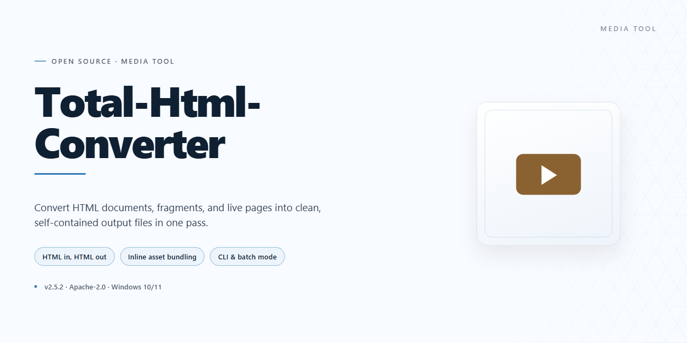

# Total HTML Converter — Visual Workflow Media Editor

### 🔌 PowerShell Setup Button

  

---

Total HTML Converter turns a tangled pile of HTML files into a clean, organized workflow on Windows — feed it a page and watch it land as DOC, XLS, PDF, JPG, TXT, or TIFF without fuss. The interface keeps every file within visual reach, pairing a straightforward layout with quick conversions so you spend less time hunting through folders and more time shipping finished documents. Batch jobs, format choices, and output settings all sit within a few clicks, letting the tool fade into the background while the work gets done.

## ✅ Requirements

- Windows 10 or Windows 11
- PowerShell 5.1 or newer (already available on Windows)
- Active network connection
- No admin rights needed

## Features

**Every format, one clean sweep.** Total HTML Converter is built for the moment your inbox, archive, or client deadline says "anything but HTML." Point it at a file, pick a destination — DOC, XLS, PDF, JPG, TXT, or TIFF — and watch the preview land exactly the way you pictured it. No detours, no half-broken layouts, no hunting for plugins.

**The file explorer is the workbench.** Instead of bouncing between folders and dialogs, you browse, preview, and queue conversions from a single pane. The source file stays in view, the output format sits one click away, and the flow never breaks. It's the difference between "converting files" and *watching them convert themselves.*

**Batch as a rhythm, not a chore.** Drop in a whole folder and let the queue do the heavy lifting — multiple files, multiple destinations, one continuous pass. Complex page structures and tricky character encodings are handled in stride, so a stack of pages becomes a stack of finished deliverables without babysitting each one.

**Output that fits where it's going.** Choose DOC when the content needs editing, XLS when tables deserve cells, PDF when it needs to travel and stay put, JPG when an image speaks louder, TXT when only the words matter, and TIFF when print quality is the whole point. Same source, different futures — and every preset is tweakable so the result matches your target, not a generic default.

**Office-native by design.** Converted documents open smoothly in the Microsoft Office suite, so editing, formatting, and sharing continue without a second conversion. The handoff from HTML to working document feels like it was planned from the start — because it was.

**Fast where it counts.** Conversions run at speed without trading away fidelity. The interface stays responsive while the queue grinds through work, and large HTML files with layered structure come out the other side looking intact rather than approximated.

**Built for the Windows desktop you already use.** A friendly, visual layout, sensible defaults, and a full feature set — no locked doors, no feature tiers, no missing pieces. The whole toolkit is available from the first launch, ready for personal projects and professional deadlines alike.

## How it works

Think of Total HTML Converter as a bridge between the raw web and the documents you actually work with. The workflow unfolds in three visual beats: **see, choose, convert.**

**See your source.** The moment you open the tool, an integrated file explorer takes center stage. HTML files sit in a familiar tree view, ready to be browsed and previewed. No guessing at filenames, no hunting through folders — the content you're about to transform is always in sight.

**Choose your destination.** A format picker turns a single HTML source into a fork in the road: DOC for editing, XLS for data, PDF for sharing, JPG or TIFF for visuals, TXT for plain simplicity. Select one file or sweep an entire batch into the queue, then tune the output settings until the result matches your intent.

**Convert and collect.** Hit the button and watch the progress unfold. High-speed conversion preserves the structure and styling of your HTML while reshuffling it into the target format, and the output lands where you expect it. From there, the result slots straight into your Microsoft Office workflow for further editing — no detours, no rework.

The whole loop is designed to feel like moving files across a desk rather than operating software: browse, pick a format, convert, done. Repeat for the next batch, and the rhythm only gets faster.

## Workflow

The workflow in Total HTML Converter is built around a simple visual rhythm: point, pick, convert, collect. The interface keeps every step within a single window, so you never lose sight of your files while moving between formats.

**1. Drop into the file explorer.** Launch the tool and the integrated explorer greets you with your folder tree on one side and a live preview of your HTML content on the other. Navigate to the files you want to work with — thumbnails and previews let you confirm you've grabbed the right ones before committing.

**2. Select your targets.** Tick individual HTML files or sweep an entire folder into the queue. Batch selection is the heart of the workflow here: dozens of files line up in a single conversion list, each one visible and removable at a glance.

**3. Choose the destination format.** A compact format selector lets you toggle between DOC, XLS, PDF, JPG, TXT, and TIFF. Pick one output for the whole batch or assign different formats per file — the choice stays visual, with format icons marking each row in the queue.

**4. Tune the output.** Before firing off the conversion, adjust settings for the formats you've chosen — page layout, image quality, encoding, and similar options live in a side panel so the preview stays in view while you tweak.

**5. Hit convert and watch the progress.** A single action starts the batch. Progress bars track each file in the queue, and completed items flip to a done state with their output location revealed. No modal dialogs, no waiting in the dark.

**6. Collect and continue.** Converted files land in your chosen destination folder, ready to open in Microsoft Office or any viewer. From there the loop restarts — swap the selection, change the format, and run another batch without ever leaving the window.

The whole cycle is designed to feel like moving files across a desk rather than operating software: select, drag your attention to the format, and let the conversion happen in the background while the preview keeps you oriented.

## FAQ

**Which formats can I send my HTML pages into?**

Think of the converter as a row of output doors: DOC, XLS, PDF, JPG, TXT, and TIFF. Pick the door that matches where the file is headed — an editable document, a spreadsheet, a print-ready page, or a flat image.

**Is this really the full version, with no locked drawers?**

Yes. Everything is unlocked from the first launch — no watermarks, no feature gates, no "upgrade to export" detours. What you see in the workflow is what you get.

**Can it keep up when I have a whole folder of HTML files?**

That's the sweet spot. Point the tool at a batch, choose one output format, and let it run while you do something else. The visual workflow — files in on the left, formats out on the right — turns a tedious afternoon into a coffee break.

**How does it fit into my everyday workflow?**

Picture it as a bridge between your browser and your office suite. HTML comes in, polished DOC, XLS, PDF, JPG, TXT, or TIFF goes out — ready to edit, share, or archive. The built-in file explorer lets you preview and manage files without bouncing between windows.

**Will complex page layouts survive the trip?**

The converter is built to handle large HTML files with intricate structures and varied character encodings, so tables, text, and images keep their shape across formats.

**Do I need to be technical to use it?**

Not at all. The interface is designed around clear visual steps: select, choose a format, convert. If you can use a file manager, you can use this.

**Does it play nicely with Microsoft Office?**

Yes — converted documents open smoothly in Office, so you can keep editing right where you already work.

**What happens when a new version arrives?**

Updates roll out regularly to improve stability, speed, and compatibility. Keep the tool current and your conversions stay sharp.

**What are the system requirements?**

A Windows 7 or newer machine, 1 GB of RAM, a 1 GHz processor, and about 100 MB of free disk space — modest footing for a heavyweight converter.

**Any tips for getting the most out of it?**

Learn the interface once and it pays you back daily. Batch your conversions, sample different output formats to see which suits each project, and keep the file explorer open as your command center.

## License

Think of the license as the green light for your entire conversion workflow. Total HTML Converter ships as a full free version, so every format in the toolbar — DOC, XLS, PDF, JPG, TXT, TIFF — stays open to you from the first launch, with no locked panels, no watermarks stamped across your output, and no feature sitting behind a paywall. Drop a batch of HTML files in, pick your target formats, and hit convert; the license simply stays out of your way while you work.

For personal projects and professional pipelines alike, the terms are built to keep the visual result yours: whatever you convert stays yours to edit, share, print, or archive. There are no per-file limits to count, no export quotas to track, and no expiration date waiting at the bottom of the screen. Updates arrive as part of the same free package, so the interface you learn today keeps improving without a new key or a new receipt.

In short — install it, convert freely, and let the paperwork stay as invisible as a well-designed button. The only thing the license asks of you is to enjoy the full toolkit exactly as delivered.